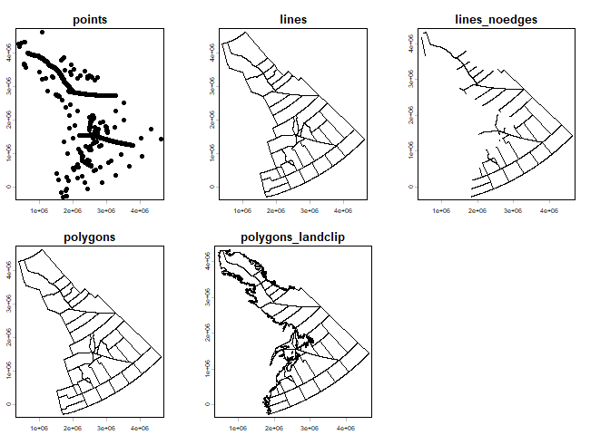

<!-- README.md is generated from README.Rmd. Please edit that file -->

<!-- You'll still need to render `README.Rmd` regularly, to keep `README.md` up-to-date. `devtools::build_readme()` is handy for this. -->

<!-- If figures are rendered here, don't forget to commit and push the resulting figure files, so they display on GitHub and CRAN. -->

# canadeamaps

<!-- badges: start -->

<!-- badges: end -->

**This is an experimental R package currently in development!**

The goals are:

- Make it easy to download commonly used spatial layers relevant to DFO
  in their original format (e.g. .shp, .csv, etc. For example, the EEZ,
  national Bioregions, and other files that are currently provided
  Canada-wide on Federal data platforms.
- Reduce the number of dependendies, and use the `terra` package for
  spatial data wrangling.
  - If you prefer to use `sf`, you can transform loaded vector data
    using the `st_as_sf()` function

This project is part of the Ecosystem Approach to Fisheries Management
workshop, to support the
[`marea`](https://marecosystemapproaches.github.io/marea/),
[`gslea`](https://github.com/duplisea/gslea/),
[`pacea`](https://github.com/pbs-assess/pacea/tree/main), `arcea`, and
`nlea` R packages.

## Installation

You can install the development version of canadeamaps from
[GitHub](https://github.com/) with:

``` r
# install.packages("pak")
pak::pak("MarEcosystemApproaches/canadeamaps")

# install.packages("remotes")
remotes::install_github("MarEcosystemApproaches/canadeamaps")
```

## Examples

- `get_bioregions()` will retrieve the [Federal Marine
  Bioregions](https://open.canada.ca/data/en/dataset/23eb8b56-dac8-4efc-be7c-b8fa11ba62e9)
- `get_ebsas()` retrieves [Ecologically and Biologically Significant
  Areas](https://open.canada.ca/data/en/dataset/d2d6057f-d7c4-45d9-9fd9-0a58370577e0).
  Since this file is large, it might be slow to display. You can subset
  to one or more specific oceans with the `ocean =` variable. For
  example:
  - `get_ebsas(ocean = "Pacific")` will pull only Pacific Ocean EBSAs
    into your R environment.
  - `get_ebsas(ocean = c("Arctic","Atlantic"))` will subset all EBSAs in
    both the Atlantic and Arctic oceans.
- `get_mpas()` retrieves [Ocean’s Act Marine Protected
  Areas](https://open.canada.ca/data/en/dataset/a1e18963-25dd-4219-a33f-1a38c4971250)
  - By default, this loads just the outer boundaries of each MPA into
    your session, as the original file download has MPA subzones as
    separate polygons.
  - To keep the file in its original form and load the Zones, use
    `get_mpas(outer = FALSE)`.
- `get_nafo()` retrieves [Northwest Atlantic Fisheries Organization
  (NAFO) Subareas, Divisions, and
  Subdivisions](https://open.canada.ca/data/en/dataset/59af1c96-fc8f-4fa0-b398-d65e953eadaa).
  You can specify whether you want to load the downloaded point, lines,
  or polygons layers with the `type =` option:
  - `"polygons"` (the default): NAFO areas as individual polygons.
  - `"lines"`: NAFO areas as lines, including edges (looks identical to
    the `"polygons"`, but is separate line segments)
  - `"points"`: points of the vertices of the NAFO areas.
  - `"lines_noedges"`: Lines of internal boundaries, but no external
    edges
  - `"polygons_landclip"`: NAFO polygons over ocean, with area
    overlapping land clipped out.

Let’s take a look at these different NAFO layers:

``` r
library(canadeamaps)
library(terra)

nafo_points = get_nafo(type = "points")
nafo_lines = get_nafo(type = "lines")
nafo_lines_noedges = get_nafo(type = "lines_noedges")
nafo_polys = get_nafo(type = "polygons")
nafo_polys_landclip = get_nafo(type = "polygons_landclip")

nafo = c(nafo_points, nafo_lines, nafo_lines_noedges, nafo_polys, nafo_polys_landclip)
names(nafo) = c("points","lines","lines_noedges","polygons","polygons_landclip")

plot(nafo)
```



<details>

<summary>

#### Wishlist layers (click to expand):

</summary>

- [x] oceans act MPAs
- [ ] EEZs
- [x] Bioregions
- [x] NAFO areas
- [ ] Coastlines - future ability to add region-specific high resolution
  ones?

</details>
